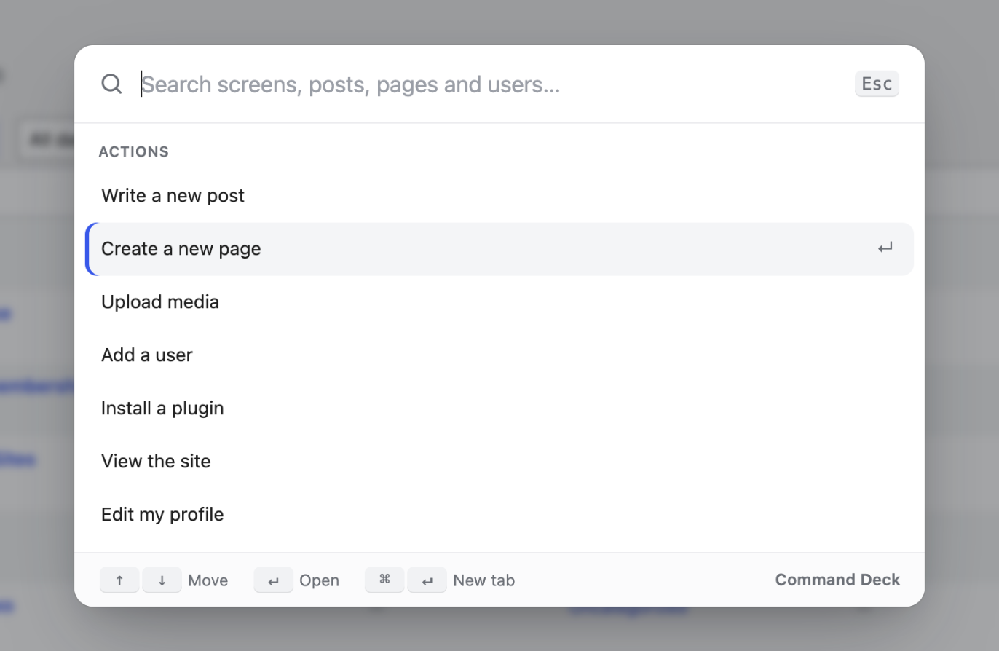

# Command Deck

**Press ⌘K (or Ctrl+K) anywhere in wp-admin and go straight to what you want.**

WordPress admin menus get long fast. Command Deck puts one search box on top of all of it: every admin screen, your posts and pages, your users and common actions, all reachable without touching the sidebar.



## Why it's nice to use

- **Nothing to set up.** Activate it and press ⌘K. There's no settings page.
- **Forgiving search.** Type `plug add` and you get *Plugins › Add New*. Letters only have to appear in order, so typos in the middle still find things.
- **Finds your content too.** After two letters it also searches posts, pages and users, and opens the editor for the one you pick.
- **Remembers where you go.** Your last five picks show at the top when the box opens.
- **Keyboard first, mouse friendly.** Use ↑ ↓ to move, ↵ to open and ⌘↵ to open in a new tab. There's also a *Search* button in the admin bar.
- **Respects permissions.** People only see screens and actions their role can use. Search goes through the normal REST API, so private content stays private.
- **Fits your admin.** It picks up your admin colour scheme and works on phones.
- **Gets out of the editor's way.** In the block editor, ⌘K is left to WordPress (links and its own command menu). The admin bar button still opens Command Deck.

## Install

1. Download this repository as a ZIP (**Code → Download ZIP**).
2. In WordPress go to **Plugins → Add New → Upload Plugin** and upload the ZIP.
3. Activate it and press **⌘K / Ctrl+K**.

Requires WordPress 6.3+ and PHP 7.4+. No build step. It's plain PHP, CSS and JavaScript.

## For developers

Add your own actions with a filter:

```php
add_filter( 'command_deck_actions', function ( $actions ) {
	$actions[] = array(
		'title' => 'Clear the page cache',
		'url'   => admin_url( 'admin.php?page=my-cache&flush=1' ),
		'group' => 'Actions',
		'keys'  => 'purge flush', // extra words that should match
	);
	return $actions;
} );
```

## Files

```
command-deck.php          Menu collection, actions, admin bar button
assets/command-deck.js    The palette (no framework, uses wp.apiFetch for search)
assets/command-deck.css   Styles
```

## License

GPL-2.0-or-later. Built by [Rohan Salave](https://www.linkedin.com/in/rohan-salave-362475189/).
